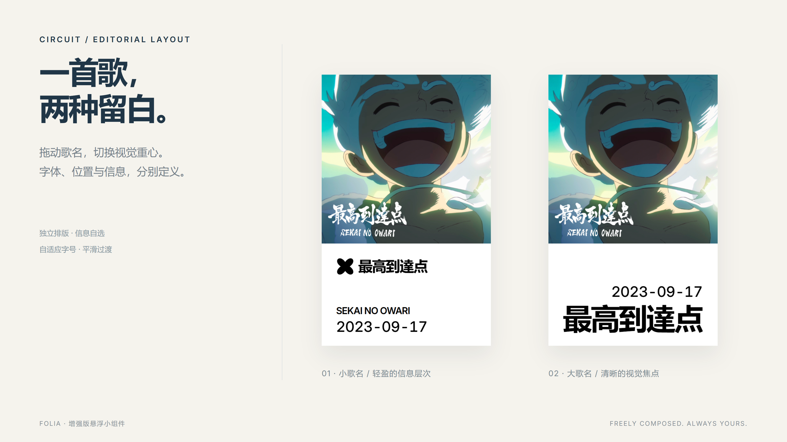
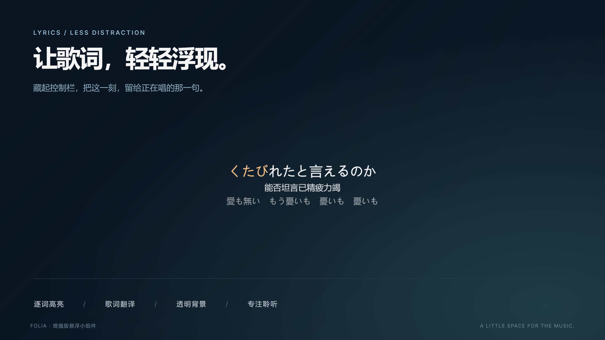

# Folia 增强版悬浮小组件

Folia 桌面音乐小组件，当前版本 1.15.5，适配 Folia 0.7.22 及后续 0.7.x 版本。

支持海报、胶囊、全功能、纯歌词和 Circuit 五种布局，提供自由排版、歌词翻译、逐词高亮、独立设置窗口、可配置滚轮操作、沉浸模式、未播放时隐藏和整窗切歌播报。

## 自由排版

小歌名与大歌名各保存一套排版。拖动歌名切换重心，独立调整字号、位置与显示信息。

## 专注歌词

逐词高亮与翻译，支持透明背景、隐藏控制栏，以及字号、颜色与描边调整。

展示图由当前组件代码实际渲染并排版，使用真实歌曲封面；演示文字与界面设置用于说明功能。[图片与素材来源](docs/visuals/CREDITS.md)。

## 安装

将本仓库的 enhanced-remote-widget 文件夹复制到 Folia 的 mods 目录，在模组管理面板启用并确认权限。Windows 的目录为 %APPDATA%\Folia\mods。

[详细说明与权限用途](enhanced-remote-widget/README.md) · [设计说明](enhanced-remote-widget/DESIGN.md)

## 兼容与验证范围

兼容范围为 `>=0.7.22 <0.8.0`。使用公开的音量、歌曲详情、歌词时钟、存储和生命周期接口，已清除 Folium 2 将移除的旧写法；原有窗口与排版设置继续保留。

当前官方稳定版提供 Folium 1.7，所以清单仍声明 `folium: 1`。Folium 2 正式发布后需核对其实际契约并更新清单主版本。

1.15.5 包含 1.15.4 的宿主兼容修复及新版展示图，已通过宿主官方模组检查，无兼容性错误或弃用提醒；另有严格接口模拟验证，尚未完成真实宿主的多屏、DPI、透明窗口及长期运行验收。展示图不等同于完整实机验收。市场新版本收录需要 Folium 维护者审核与签名。

## 许可证

项目源码采用 [MIT](LICENSE)。随附的 Inter 字体采用 [SIL Open Font License 1.1](enhanced-remote-widget/INTER-LICENSE.txt)。
